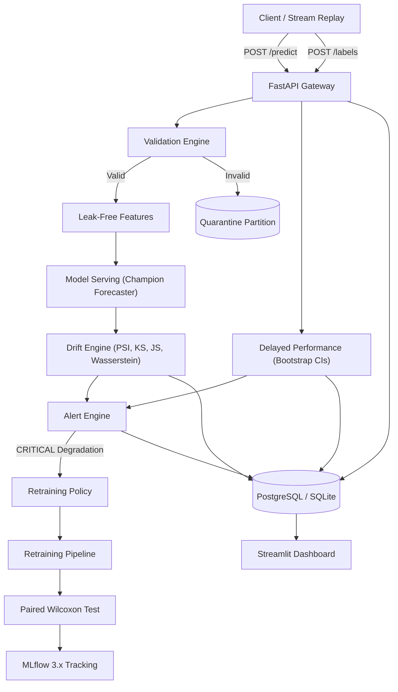

# DriftWatch

> A production ML monitoring platform for demand forecasting that separates statistical input drift from actual performance degradation.

DriftWatch monitors tabular ML models in production, specifically retail demand forecasters. Most monitoring setups alert whenever an input feature shifts, which produces alert fatigue when the model handles the shift fine. DriftWatch separates statistical shift from performance degradation. Input and prediction shifts can raise warnings at most; critical alerts and retraining triggers require verified accuracy decay on delayed ground-truth labels.

---

## Benchmark Results

I ran the detector benchmark (`python monitoring/benchmark/run_benchmark.py`) across random seeds (240 individual tests on stationary null distribution where $H_0$ is true):

| Multiple Testing Strategy | Measured False Positive Rate (FPR) | Notes |
| :--- | :--- | :--- |
| Raw uncorrected p-values ($p < 0.05$) | **1.67%** | Expected nominal false positive rate ($\approx \alpha=5\%$) |
| Benjamini-Hochberg (BH) FDR | **0.00%** | Controls false discovery rate under dependence |
| Bonferroni FWER | **0.00%** | Strict family-wise error rate control |
| Dual-gating (BH $p < 0.05$ and Effect Size $\ge \tau$) | **2.92%** | Substantive effect threshold eliminates spurious statistical noise |

Statistical power reaches 100% across all tests once shift magnitude reaches $\Delta \ge 0.5\sigma$ ($N=500$, $\alpha=0.05$). Average execution time per 1,000 samples: Jensen-Shannon 0.078 ms, Wasserstein 0.283 ms, PSI 0.229 ms, Kolmogorov-Smirnov 0.493 ms. Agreement with Evidently 0.7+ `DataDriftPreset` across detected columns was 100.0%.

The baseline forecast benchmark on the holdout split:

| Model | MAE | RMSE | WAPE | MASE | Bias | WRMSSE |
| :--- | :--- | :--- | :--- | :--- | :--- | :--- |
| Seasonal-Naive ($y_t = y_{t-7}$) | 9.42500 | 13.524635 | 0.289926 | 0.597025 | -0.489815 | 0.953620 |
| XGBoost Regressor | 4.78696 | 6.282799 | 0.147253 | 0.303229 | -0.503561 | 0.453338 |

XGBoost achieves a 49.2% MAE reduction over the seasonal baseline.

---

## Limitations

1. **Intermittent retail demand**: Real retail series (like Kaggle M5) have long runs of zero-sales days. The default XGBoost regressor minimizes squared error; for intermittent series with high zero counts, Tweedie regression or Croston's method would produce tighter intervals.
2. **Kaggle M5 data access**: Kaggle requires login credentials, so the project cannot download M5 directly. If you have the files, drop `sales_train_evaluation.csv` and `calendar.csv` into `data/m5/`. If absent, the system runs on a deterministic synthetic retail generator (`src/driftwatch/data/synthetic.py`, seed 42) and marks all records as synthetic.
3. **Label-free estimation breaks under concept drift**: The label-free performance estimator (`src/driftwatch/monitoring/label_free.py`) uses density-ratio importance weights. It only holds under covariate shift ($P(X)$ changes while $P(Y \mid X)$ remains fixed). If customer buying behavior shifts, label-free estimates become unreliable, so they are always tagged `ESTIMATED_PERFORMANCE` and never trigger retraining.
4. **Synchronous jobs**: Retraining jobs currently run in-process under database locks. For heavy production traffic, this should be offloaded to Celery or RQ workers.

---

## Quickstart

### Setup
```bash
git clone https://github.com/khushaalsrivastava444-cmyk/DriftWatch.git
cd DriftWatch
pip install -e ".[dev]"
```

### Run the demo (takes ~20 seconds on CPU)
```bash
make demo
# or directly: python scripts/run_demo.py
```

This runs through the full lifecycle:
1. Initializes SQLite database and trains Champion v1.
2. Serves 600 baseline predictions and ingests delayed ground truth.
3. Injects concept drift and serves 600 drifted predictions.
4. Runs multi-feature statistical drift tests with Benjamini-Hochberg FDR control.
5. Emits a `STATISTICAL_SHIFT` warning alert.
6. Computes delayed accuracy and 95% stationary block bootstrap confidence intervals.
7. Triggers retraining, trains Candidate v2, and runs a paired Wilcoxon signed-rank test against Champion v1.
8. Registers Candidate v2 as inactive (`is_active_champion=False`).
9. Promotes v2 to champion with an audit log record, then rolls back to v1.
10. Generates 90% conformal prediction intervals and exports an Evidently HTML report.

### Run tests and checks
```bash
make test       # 42 unit, integration, simulation, and property tests
make lint       # ruff check src/ tests/ scripts/
make typecheck  # mypy src/driftwatch
```

### Start the UI and API
```bash
make ui         # Streamlit dashboard on http://localhost:8501
make api        # FastAPI server on http://localhost:8000
```

---

## Skills Demonstrated

- **Statistical testing**: Two-sample Kolmogorov-Smirnov, Population Stability Index (PSI with reference quantile binning and Laplace smoothing), Jensen-Shannon divergence, normalized Wasserstein-1 distance, Benjamini-Hochberg FDR, and Bonferroni adjustments.
- **Time series and forecasting**: Leak-free temporal feature pipelines (lags, rolling statistics with 1-period shifts, calendar features), seasonal-naive baselines, XGBoost demand forecasters with early stopping, MASE, WAPE, and WRMSSE evaluation.
- **MLOps and production serving**: FastAPI serving gateway with request correlation IDs and idempotent deduplication, delayed ground-truth matching with maturity tracking, stationary block bootstrap 95% confidence intervals on autocorrelated time series errors.
- **Model governance and retraining**: Retraining trigger policies (rejecting drift-only triggers), paired Wilcoxon signed-rank comparison between champion and challenger on holdout splits, MLflow 3.x tracking and artifact registry, decoupled audited promotion and rollback.
- **Uncertainty quantification**: Inductive split conformal prediction intervals with empirical coverage auditing, domain classifier AUC drift attribution, data contract schema validation with quarantine routing.
- **Monitoring UI**: Interactive 7-page Streamlit console querying relational databases (PostgreSQL and SQLite) directly with zero mocked metrics.

---

## Core Principle: Evidence Classes

Drift is not degradation. DriftWatch tags every metric and alert with an evidence class:

| Evidence Class | Data Source | Ground Truth? | Max Alert Severity | Retraining Allowed? |
| :--- | :--- | :--- | :--- | :--- |
| `STATISTICAL_SHIFT` | Input features ($X$), reference vs current | No | `WARNING` | No |
| `PREDICTION_SHIFT` | Forecast values ($\hat{y}$), reference vs current | No | `WARNING` | No |
| `ESTIMATED_PERFORMANCE` | Density-ratio importance-weighted error | No | `INFO` | No |
| `VERIFIED_PERFORMANCE` | Delayed labels matched to predictions | Yes ($\ge 80\%$ coverage) | `CRITICAL` | Yes (if paired test passes) |

Rules enforced in code:
- Statistical drift alone cannot raise a `CRITICAL` alert and cannot auto-trigger retraining.
- A `CRITICAL` alert requires verified performance degradation where the 95% stationary block bootstrap confidence interval breaches the threshold.
- Retrained models are registered with `is_active_champion = False`. They are promoted only through an explicit, audited action after a paired Wilcoxon signed-rank test confirms lower error on holdout data ($p < 0.05$).
- Delayed performance windows with $<80\%$ label coverage are marked `UNVERIFIED`.

---

## Architecture



---

## Statistical Methods

### 1. Population Stability Index (PSI)
Binned against reference sample quantiles with Laplace smoothing ($\epsilon=10^{-4}$):

$$PSI = \sum_{b=1}^{B} (P_b - Q_b) \ln\left( \frac{P_b}{Q_b} \right)$$

Thresholds: $<0.10$ nominal, $0.10 \le PSI < 0.25$ moderate shift, $\ge 0.25$ severe drift.

### 2. Kolmogorov-Smirnov Two-Sample Test
Supremum distance between empirical cumulative distributions:

$$D_{n, m} = \sup_{x} |F_n(x) - G_m(x)|$$

Dual-gating requires $p_{\text{adj}} < 0.05$ and $D_{n,m} \ge 0.10$.

### 3. Jensen-Shannon Divergence
Symmetric version of Kullback-Leibler divergence, bounded in $[0, 1]$ using base 2:

$$M = \frac{1}{2}(P + Q), \quad JSD(P \parallel Q) = \frac{1}{2} D_{KL}(P \parallel M) + \frac{1}{2} D_{KL}(Q \parallel M)$$

### 4. Normalized Wasserstein-1 Distance
Measures the minimal work to shift one distribution to another, normalized by reference standard deviation for cross-feature comparability:

$$\tilde{\mathcal{W}}_1 = \frac{1}{s_{\text{ref}} + 10^{-6}} \int_{-\infty}^{\infty} |U(x) - V(x)| dx$$

### 5. Chi-Square and Cramér's V
For discrete features, dual-gating requires $p_{\text{adj}} < 0.05$ and Cramér's $V \ge 0.15$:

$$V = \sqrt{\frac{\chi^2}{N \min(r - 1, c - 1)}}$$

### 6. Multiple-Testing Adjustment
Testing multiple features simultaneously inflates false positive rates. DriftWatch applies Benjamini-Hochberg False Discovery Rate control by default:

$$q_{(i)} = \min_{j \ge i} \left\{ \min\left(1, \frac{M}{j} P_{(j)}\right) \right\}$$

Bonferroni family-wise error adjustment ($p_{\text{adj}} = \min(1, M \cdot P)$) is available as a stricter alternative.

### 7. Stationary Block Bootstrap for Delayed Degradation
Standard bootstrap assumes i.i.d. observations, which fails on autocorrelated forecast errors. DriftWatch uses the Politis and Romano (1994) stationary block bootstrap with geometric block lengths:

$$P(L = \ell) = (1 - p)^{\ell - 1} p, \quad \mathbb{E}[L] = \frac{1}{p}$$

Degradation is confirmed only when the 95% confidence interval lower bound breaches the baseline error threshold: $\text{MAE}_{0.025} > \text{Baseline} \cdot (1 + \delta)$.

### 8. Paired Wilcoxon Signed-Rank Test for Retraining
Challenger models must demonstrate lower error than the active champion on holdout data. Absolute errors are paired by record:

$$d_i = |y_i - \hat{y}_i^{\text{champ}}| - |y_i - \hat{y}_i^{\text{cand}}|$$

The candidate is approved for promotion only if the Wilcoxon test rejects the null hypothesis at $\alpha=0.05$ and candidate MAE is strictly lower.

### 9. Inductive Split Conformal Prediction
Produces distribution-free prediction intervals $[\max(0, \hat{y} - \hat{q}), \hat{y} + \hat{q}]$ at target coverage $1-\alpha$:

$$\hat{q} = \text{Quantile}\left( \{|y_i - \hat{f}(x_i)|\}, \frac{\lceil (n+1)(1-\alpha) \rceil}{n} \right)$$

---

## Project Structure

```
Drift Watch/
├── src/driftwatch/
│   ├── alerts/         # Evidence-gated alert engine and notification handlers
│   ├── api/            # FastAPI endpoints, auth, and model serving service
│   ├── data/           # Synthetic demand generator and M5 dataset loader
│   ├── db/             # SQLAlchemy models and retention pruning
│   ├── drift/          # PSI, KS, JS, Wasserstein, multiple testing, attribution
│   ├── features/       # Leak-free lag and rolling statistics pipeline
│   ├── models/         # Baseline forecaster, XGBoost, conformal intervals
│   ├── monitoring/     # Delayed performance, bootstrap CIs, label-free estimation
│   ├── retraining/     # Retrain pipeline, paired Wilcoxon test, MLflow registry
│   ├── simulation/     # 7 drift injectors and chronological replay runner
│   ├── ui/             # Streamlit 7-page monitoring console
│   └── validation/     # Ingestion schema validation and quarantine routing
├── tests/              # 42 unit, integration, simulation, and property tests
├── monitoring/         # Single-command detector benchmark runner
├── docs/adr/           # Architecture decision records
├── scripts/            # Single-command demo script
├── Makefile
├── Dockerfile
└── docker-compose.yml
```

---

## Architecture Decision Records

- [ADR 0001: Library choices and version pinning](docs/adr/0001-stack-and-libraries.md)
- [ADR 0002: Decoupled Evidently 0.7+ cross-checks](docs/adr/0002-evidently-integration.md)
- [ADR 0003: Evidence classification and alert gates](docs/adr/0003-evidence-classification-and-alert-gates.md)
- [ADR 0004: Retraining governance and paired hypothesis testing](docs/adr/0004-retraining-governance-and-paired-hypothesis-testing.md)

---

## License

Apache 2.0
