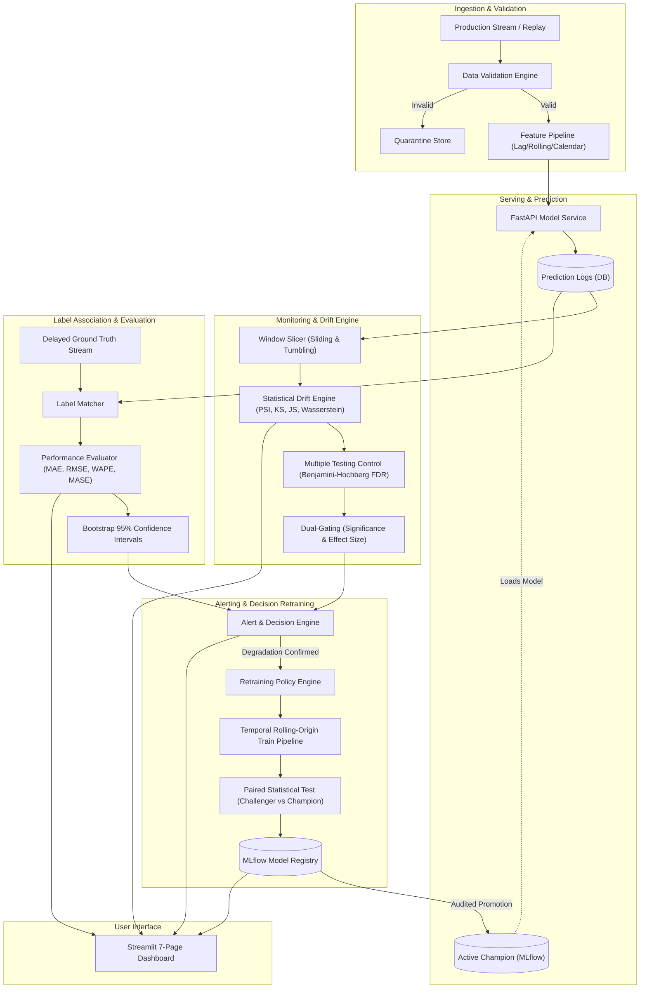

# DRIFTWATCH: Architectural Plan & Engineering Blueprint

> **System Mission**: Real-time production ML drift detection, performance degradation estimation, delayed-label association, hypothesis-driven statistical control, and statistically guarded retraining.
> **Core Principle**: *Drift is not degradation*. Every alert and UI signal carries an explicit evidence classification:
> `STATISTICAL_SHIFT | PREDICTION_SHIFT | ESTIMATED_PERFORMANCE | VERIFIED_PERFORMANCE`.

---

## 1. System Architecture & Topology

### Component Details
1. **Data & Feature Engineering (`src/driftwatch/data/`)**:
   - Seeded synthetic retail-demand generator (`generate_synthetic_demand`) with seasonal, trend, price elasticity, day-of-week, and promotion components. Fully deterministic provenance.
   - M5 Kaggle format fallback loader (`load_m5_data`) for local CSV files.
   - Leak-free chronological train/val/test splits.
   - Feature engineering with strictly backward-looking lag terms ($t-1, t-7, t-14, t-28$), rolling aggregations (mean, std, min, max over 7/14/28 days shifted by 1), calendar indicators, and reference quantile statistics computed strictly on the training partition.

2. **Validation Engine (`src/driftwatch/validation/`)**:
   - Configurable rules: schema adherence, strict data types, null thresholding, duplicate primary keys, value range intervals, timestamp continuity, unseen category handling, and Tukey outlier fences.
   - Quarantine routing for non-compliant batches with complete violation manifests.

3. **Drift Detection Engine (`src/driftwatch/drift/`)**:
   - **PSI (Population Stability Index)**: Reference-quantiled bins with Laplace smoothing ($\epsilon = 10^{-4}$); support for continuous and categorical distributions.
   - **Kolmogorov-Smirnov Test**: Two-sample continuous test via `scipy.stats.ks_2samp`.
   - **Jensen-Shannon Divergence**: Symmetric, smoothed, bounded divergence $\in [0, 1]$ on normalized reference vs target histograms.
   - **Wasserstein Distance**: Earth Mover's Distance for continuous real-valued shifts.
   - **Chi-Square Test**: Goodness-of-fit / contingency for categorical frequency shifts.
   - **Statistical Shifts**: Mean shift, variance shift, missingness rate shifts, prediction distribution divergence.
   - **Multiple Testing Control**: Benjamini-Hochberg (BH) False Discovery Rate control (default) and Bonferroni Family-Wise Error Rate control (option).
   - **Dual-Gating Decision Rule**: Requires statistical significance ($p_{\text{adj}} < \alpha$) **AND** minimum substantive effect size (e.g. $\text{PSI} \ge 0.1$, $|\Delta \mu| / \sigma \ge 0.2$) to mitigate sample size collapse ($N > 10,000$).
   - **Temporal Hysteresis**: $k$-of-$n$ persistent breaches required for alert escalation; recovery requires consecutive non-breaching windows below trigger threshold.

4. **Persistence & Data Models (`src/driftwatch/db/`)**:
   - SQLAlchemy 2.0 ORM with PostgreSQL & SQLite support.
   - Models: `Model`, `ModelVersion`, `Dataset`, `ReferenceDataset`, `PredictionLog`, `GroundTruthLabel`, `DriftReport`, `FeatureDriftResult`, `PerformanceReport`, `Alert`, `RetrainingJob`, `ModelEvaluation`, `AuditLog`.
   - Optimized indexes on `(model_id, timestamp)`, `(prediction_id)`, and `(window_start, window_end)`.

5. **Inference API (`src/driftwatch/api/`)**:
   - FastAPI 0.136+ with async support.
   - Endpoints: `POST /api/v1/predict`, `POST /api/v1/predict/batch`, `GET /models`, `GET /models/active`, `GET /models/{id}`, `GET /health`, `POST /api/v1/labels`, `POST /api/v1/monitor/drift`, `POST /api/v1/models/retrain`, `POST /api/v1/models/{id}/promote`, `POST /api/v1/models/{id}/rollback`.
   - Unique `request_id`, execution latency instrumentation, duplicate prediction ID deduplication, API key auth on write/admin routes.

6. **Performance Evaluator & Delayed Ground-Truth (`src/driftwatch/monitoring/`)**:
   - Asynchronous matching between prediction logs and delayed arrival labels.
   - Label coverage and delay distribution statistics.
   - Metrics: MAE, RMSE, WAPE ($\sum |y - \hat{y}| / \sum y$), MASE ($\text{MAE} / \text{MAE}_{\text{seasonal naive}}$).
   - Stationary block bootstrap 95% confidence intervals on rolling performance metrics. Degradation defined as non-overlapping confidence interval breach against champion baseline.

7. **Replay Simulator & Detector Benchmark (`src/driftwatch/simulation/`, `monitoring/benchmark/`)**:
   - Time-ordered replay feeding real API in chronological batches.
   - Injection suite: stable baseline, mean shift, variance expansion, categorical shift, missingness spikes, prediction drift, and concept drift ($P(Y|X)$ modification).
   - Benchmark suite computing Empirical False Positive Rate (FPR), Detection Delay (number of steps to alert), Statistical Power vs Shift Magnitude, and Evidently agreement metrics across 20+ seeds.

8. **Retraining & Champion-Challenger Workflow (`src/driftwatch/retraining/`)**:
   - Trigger policies: sustained verified performance degradation, scheduled cadence, or explicit manual invocation. *Drift alone never triggers retraining*.
   - Rolling-origin temporal evaluation (walk-forward CV).
   - Paired Wilcoxon signed-rank / paired t-test on test errors between Challenger and Champion.
   - MLflow parameter, metric, data hash, feature config, and artifact logging.
   - Audited promotion requiring statistical superiority and explicit human/admin action. Single-step rollback capability.

9. **Streamlit 7-Page Dashboard (`src/driftwatch/ui/`)**:
   - Professional dark charcoal theme with blue/green accents.
   - 7 distinct views: Overview, Data Drift, Performance & Delays, Model Registry, Retraining & Champions, Alerts & Incidents, Data Quality.
   - Real database records only; zero mock numbers; explicit empty states; evidence badges.

---

## 2. Verified Dependency Plan

| Package | Version | Purpose | Compatibility Verification |
|---|---|---|---|
| `python` | `3.12.10` | Core runtime | System installed |
| `fastapi` | `0.136.3` | REST API framework | Verified async, Pydantic v2 compatible |
| `pydantic` | `2.13.4` | Data validation & schemas | Pydantic v2 BaseSettings integration |
| `pydantic-settings` | `2.14.2` | Environment configuration | Verified |
| `sqlalchemy` | `2.0.51` | ORM & DB abstraction | Modern 2.0 `select()`, async ready |
| `alembic` | `1.18.5` | DB schema migrations | Verified |
| `scikit-learn` | `1.8.0` | Metrics, baselines, splits | Verified |
| `scipy` | `1.17.1` | KS test, JS divergence, stats | Verified |
| `xgboost` | `3.2.0` | Production forecasting model | Verified CPU fast tree regressor |
| `pandas` | `3.0.3` | Tabular data manipulation | Verified |
| `numpy` | `2.4.6` | Numerical calculations | Verified |
| `mlflow` | `3.17.2` | Experiment tracking & registry | Local SQLite tracking, zero external server needed |
| `evidently` | `0.7.23` | Drift & quality cross-checks | Verified for HTML report generation |
| `streamlit` | `1.58.0` | Operational UI dashboard | Modern multi-page layout |
| `plotly` | `5.24.1` | Interactive charts | Compatible with Evidently and Streamlit |
| `pytest` | `9.1.1` | Test framework | Verified |
| `hypothesis` | `6.170.14` | Property-based tests | Verified |
| `httpx` | `0.28.1` | Async HTTP client for tests & simulation | Verified |
| `ruff` | `0.17.3` | Linting & formatting | Verified |
| `mypy` | `2.4.1` | Static type checking | Verified |

---

## 3. Risk Register (Top 5 Risks & Mitigations)

1. **Risk: Large-Sample-Size $p$-Value Collapse (False Alarm Flood)**
   - *Description*: Statistical tests (e.g. KS, Chi-Square) have power approaching 1.0 as $N \to \infty$. Negligible shifts ($< 1\%$ change) produce $p < 10^{-10}$, triggering false alarms.
   - *Mitigation*: Implementation of **Dual-Gating Decision Rule**. An alert requires both adjusted $p$-value $< \alpha$ **AND** substantive effect size (Cohen's $d \ge 0.2$, $\text{PSI} \ge 0.10$, Wasserstein distance exceeding reference variance threshold).

2. **Risk: Temporal Data Leakage in Feature Engineering and Reference Fitting**
   - *Description*: Standard aggregations or quantile binning on full datasets inadvertently compute bins or stats using future information, corrupting drift statistics.
   - *Mitigation*: Strict chronological splitting. Feature transformers fit parameters and rolling windows solely on past rows ($t < t_{\text{eval}}$). Reference distributions for PSI, KS, and JS are fit strictly on the training partition. An automated property test asserts zero lookahead leakage.

3. **Risk: Alert Flapping and Operator Fatigue**
   - *Description*: Natural sampling fluctuation around detection thresholds can cause alternating alert and resolve events across adjacent time windows.
   - *Mitigation*: Temporal hysteresis requiring $k$-of-$n$ windows exceeding threshold for state escalation, and a recovery deadband requiring $m$ consecutive windows falling below $(\tau - \delta_{\text{hysteresis}})$ before resolving an alert.

4. **Risk: Retraining Loops & Regression on Drifted Data**
   - *Description*: Automatically retraining models whenever drift is detected can trap models in feedback loops or train them on corrupted/unlabeled distributions.
   - *Mitigation*: Strict policy: *Drift alone never triggers retraining*. Retraining triggers only upon verified performance degradation backed by delayed ground-truth. Every retrained challenger undergoes rolling-origin temporal validation and paired error statistical testing vs the incumbent champion before promotion can occur.

5. **Risk: Delayed Label Mismatch and Premature Degradation Claims**
   - *Description*: Retail ground truth often lags by days to weeks. Evaluating models without full label arrival yields deceptive metrics.
   - *Mitigation*: All performance reports track label maturity and coverage ratios. Performance state is labeled `UNVERIFIED` until label coverage exceeds configured maturity threshold (e.g. $\ge 90\%$).

---

## 4. Milestone Definitions of Done (DoD)

- **Milestone 1: Data & Forecasting Pipeline**
  - Seeded synthetic retail-demand generator producing reproducible multi-item, multi-store series.
  - Strict chronological train-val-test splits.
  - Leak-free feature pipeline (lags, rolling stats, calendar, price).
  - Seasonal-naive baseline + XGBoost model.
  - Metrics computation: MAE, RMSE, WAPE, MASE.
  - Leakage verification test proving reference stats and lag features contain zero future data.

- **Milestone 2: Validation & Drift Engine**
  - Rule-based schema, type, range, null, duplicate, category validator.
  - PSI with quantile reference binning, Laplace smoothing, categorical support.
  - KS, JS, Wasserstein, Chi-Square, mean/std, missing-rate, prediction distribution drift tests.
  - Benjamini-Hochberg FDR control and Bonferroni adjustment.
  - Hypothesis property tests: PSI$(x, x) = 0$, JS symmetry & boundedness $[0, 1]$, row-order invariance, NaN safety.
  - Stateful window monitor with $k$-of-$n$ escalation and hysteresis.

- **Milestone 3: Database, API, & Performance Monitoring**
  - SQLAlchemy models with indices and migrations.
  - FastAPI `/api/v1/predict`, `/predict/batch`, `/models`, `/health`, `/labels`.
  - Request IDs, latency tracking, duplicate prediction handling, auth protection on write endpoints.
  - Delayed label association engine.
  - Rolling performance metrics with stationary block bootstrap 95% confidence intervals.
  - Integration test suite passing with real SQLite/PostgreSQL storage.

- **Milestone 4: Replay Simulator & Detector Benchmark**
  - Chronological replay streaming through real API endpoints.
  - Injectors: stable, mean shift, variance shift, categorical shift, missingness spike, prediction drift, concept drift.
  - Benchmark suite: false positive rate (raw vs BH-adjusted), statistical power vs shift magnitude, detection delay, runtime.
  - Output tables and plots generated from runs saved to `docs/experiments.md`.

- **Milestone 5: Alert Engine & Streamlit Dashboard**
  - Alert engine supporting `INFO`, `WARNING`, `CRITICAL` with evidence classes (`STATISTICAL_SHIFT`, `PREDICTION_SHIFT`, `ESTIMATED_PERFORMANCE`, `VERIFIED_PERFORMANCE`).
  - Critical alerts strictly gated on verified performance degradation.
  - 7-page dark charcoal Streamlit dashboard displaying real database metrics only.
  - Explicit empty states and incident acknowledgment workflow.

- **Milestone 6: Retraining, Champion-Challenger, & Audit Trail**
  - Policy engine: sustained degradation triggers retraining; drift alone rejected.
  - Temporal rolling-origin cross-validation pipeline.
  - Paired error statistical testing (Wilcoxon signed-rank / paired t-test) comparing Challenger against Champion.
  - MLflow model logging (params, metrics, data hashes, artifacts).
  - Audited promotion and one-click rollback mechanism.
  - End-to-end integration test: train -> serve -> inject drift -> alert -> retrain -> evaluate -> promote/reject -> rollback.

- **Milestone 7: Tier 2 Advanced Capabilities**
  - SHAP / Permutation feature-importance drift attribution.
  - Conformal prediction intervals (split conformal quantile regression) and empirical coverage tracking.
  - Multivariate drift detection via domain classifier AUC.
  - Label-free performance estimation (density-ratio importance weighting).
  - Evidently cross-check report with static HTML export.

- **Milestone 8: Production Polish, CI, Docker, & Documentation**
  - Docker Compose configuration for API, Postgres, MLflow, and Streamlit.
  - GitHub Actions CI workflow (linting, type checking, unit + integration tests).
  - Automated `make demo` script executing end-to-end scenario under 10 minutes on CPU.
  - README with architecture diagrams, test math, and honest limitation disclosures.

---

## 5. Scope Triage & Cut List

If quality or timeline is threatened, components will be pruned in the following strict order:
1. **Tier 3 (Cut First)**: Airflow DAG orchestrator, LLM incident triage assistant, OpenTelemetry exporter.
2. **Tier 2 (Cut Second)**: Label-free performance estimation, Shadow deployment runner, Multivariate domain classifier.
3. **Protected Core (Never Cut)**: Core drift tests (PSI, KS, JS), multiple testing control, dual-gating rule, leak-free validation, delayed label association, bootstrap performance CIs, MLflow registry, audited promotion/rollback, 7-page dashboard, integration tests.
